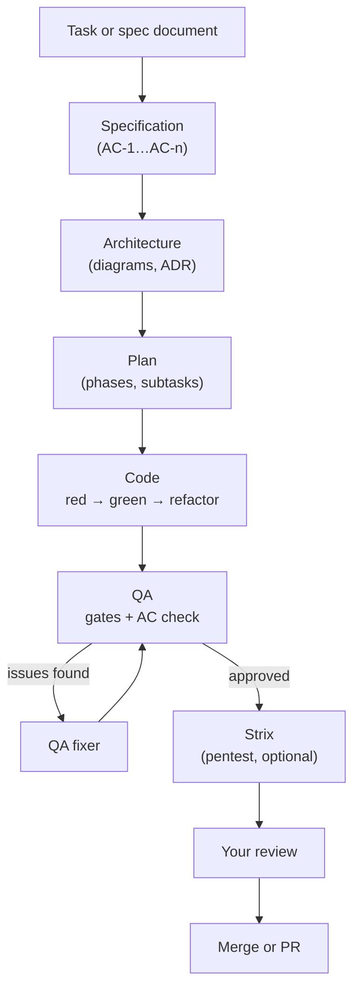

# What Vibe Teamlead is

Vibe Teamlead is a macOS app in which a team of AI agents on Claude Code builds software from a specification. You describe a task or upload a spec document, and the agents go through the same path a real team would: analyst → architect → planner → developer (test first) → QA → security check → your decision to merge. You watch the work live and answer the agents' questions when the decision is yours.

## The task path in brief

1. **You create a task** (the Create button → New task) or **upload a spec document** (`.docx`, `.md`, `.pdf`, `.txt`, `.rtf`). The spec analyst splits the document into epics and tasks right away, without asking questions: what only you can decide goes into "Open questions" and its own choices into "Assumptions", both shown on the review step, where you can edit the tasks before they are created. Questions about a single task come later, from the spec writer, when that task starts.
2. **Specification.** The agents gather requirements and write `spec.md` with acceptance criteria `AC-1…AC-n`. Each criterion has a test level: unit, integration or e2e.
3. **Architecture** (for medium and high complexity tasks). The architect writes `architecture.md`, decisions in ADR format, and draw.io and Mermaid diagrams. It renders each diagram and fixes it until it is clean.
4. **Plan.** The planner splits the work into phases and subtasks. Each subtask states which ACs it covers and which test must fail first.
5. **Code.** The coder works in an isolated copy of the repository (git worktree) using TDD: a failing test first, then the code, then refactoring. Each subtask ends with a commit.
6. **QA.** First the hard gates: gitleaks (secrets) and OSV-Scanner (vulnerable dependencies). Then the QA reviewer matches each AC to a test, runs the tests, checks the UI in a browser and writes a report. If there are issues, the QA fixer fixes them and QA runs again.
7. **Strix** (if enabled): a pentest of the changed code in Docker.
8. **Your review.** You look through the changes in the task's Workspace and decide: merge into the main branch, create a PR, or discard.

While an agent is working, it can **ask you a question** (for example, "JWT or server-side sessions?"). A panel with options appears on the right, and the agent waits for your answer. You can skip the question; the agent then decides on its own and records its assumption.
