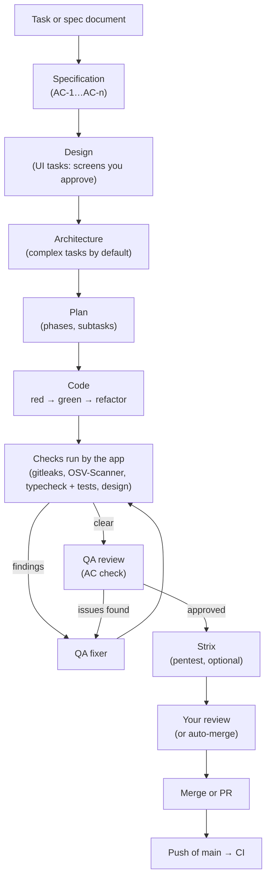

# What Vibe Teamlead is

Vibe Teamlead is a desktop app for macOS and Windows (beta) in which a team of AI agents on Claude Code builds software from a specification. You describe a task or upload a spec document, and the agents go through the same path a real team would: analyst → architect → planner → developer (test first) → QA → security check → your decision to merge. You watch the work live and answer the agents' questions when the decision is yours.

## The task path in brief

1. **You create a task** (the Create button → New task) or **upload a spec document** (`.docx`, `.md`, `.pdf`, `.txt`; `.rtf` on macOS only). First the spec analyst reads the brief and the project and asks what the brief leaves open, one question at a time, the way the Superpowers brainstorming skill does: each question says what the answer changes, offers a recommended option, and you can always type your own answer, skip, or say "Stop asking and propose". A detailed spec may get one or two questions, a few sentences more. Then it splits the brief into epics and tasks with your answers folded in. It covers the whole document, whatever its size: never only a first phase or an MVP, and each task builds its requirements as the document states them. The document's phases and priorities set the order of the tasks, not what is left out; only your own words (in the document or in an answer) leave something out. A large document comes in parts of about 25 tasks, and the analyst is asked for the next part until nothing is left. The app checks this itself: it finds the numbered requirements in the document (FR-12, NFR-03) and compares them with the tasks. If something still has no task, the review step says so first, in a block marked **Not the whole brief**, and lists apart what was left out on purpose. The review step shows your answers, its assumptions and the questions left open, and you can edit the tasks before they are created. The switch "Ask me questions first" next to Analyse turns the questions off. Each question left open names the tasks it affects. It goes into those tasks' descriptions, and their spec agent asks it when the task starts, unless it was answered already: every answer you give to an agent of a task from the document is saved with the document (`clarifications.md`), and the other tasks read it there. Questions about a single task come later, from the spec writer, when that task starts.
2. **Specification.** The agents gather requirements and write `spec.md` with acceptance criteria `AC-1…AC-n`. Each criterion has a test level: unit, integration or e2e.
   For a task that changes the interface, a designer agent then draws its screens (wireframes, then the design) and you approve them on the task's Design tab before the plan (see "Design before code").
3. **Architecture** (for complex tasks by default; the **Architect** setting can turn it on for every task or off). The architect writes `architecture.md`, decisions in ADR format, and draw.io and Mermaid diagrams. It renders each diagram and fixes it until it is clean.
4. **Plan.** The planner splits the work into phases and subtasks. Each subtask states which ACs it covers and which test must fail first.
5. **Code.** The coder works in an isolated copy of the repository (git worktree) using TDD: a failing test first, then the code, then refactoring. Each subtask ends with a commit.
6. **QA.** First the hard gates: gitleaks (secrets), OSV-Scanner (vulnerable dependencies) and Semgrep when it is installed. The app also runs the project's typecheck and tests itself. Then the QA reviewer checks that each AC has a test that really proves it, reviews the changed code, checks the UI in a browser and writes a report. It runs only the checks the app could not run. If there are issues, the QA fixer fixes them and QA runs again.
7. **Strix** (if enabled): a pentest of the changed code in Docker.
8. **Your review.** You look through the changes in the task's Workspace and decide: merge into the main branch, create a PR, or discard.

While an agent is working, it can **ask you a question** (for example, "JWT or server-side sessions?"). A panel with options appears on the right, and the agent waits for your answer. You can skip the question; the agent then decides on its own and records its assumption.
