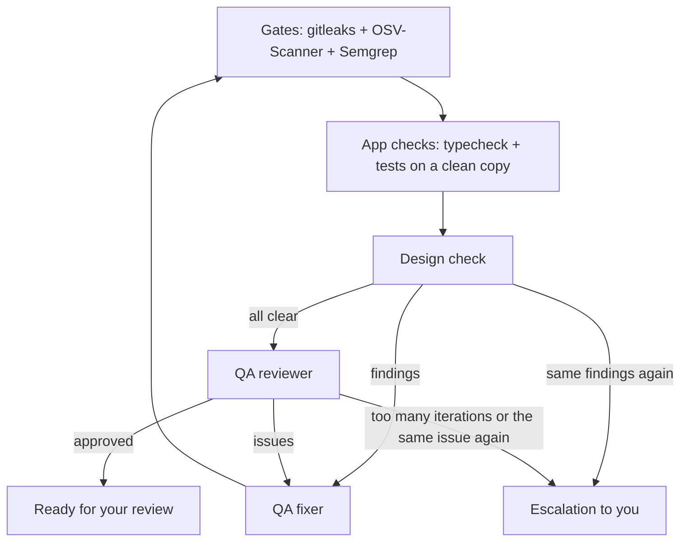

# How a task goes through the pipeline

## Which pipeline a task runs

Not every task needs the whole team. A task runs one of three pipelines:

| Pipeline | What runs | For |
|---|---|---|
| **Full** | spec → design → architecture → plan → code → QA → your review | What the rest of this page describes. |
| **Short** | a short spec with acceptance criteria and its plan → code → QA → your review | A clear, bounded job. No designer and no architect. |
| **One session** | one agent writes the acceptance criteria, the tests and the code → the app's checks and scanners → your review | A small self-contained thing: a small game, a script, a tweak. |

- **You choose** in the task form (**Pipeline**), when you create or edit the task. Your choice always wins. It applies when the task starts: changing it later does not re-plan a task that already has a plan.
- **The project's default.** Settings → Project → Queue → **Pipeline for tasks** sets the pipeline of every task that chooses none of its own, tasks from a spec document included. The task form then offers **As in the project**, and **Auto** for a task the app should decide by itself. The default does not reach tasks the architect designs, quick fixes from the preview and tasks the app makes to repair main: those keep their own pipeline.
- **Auto** (a task with no choice, in a project with no default) decides when the task starts, without stopping to ask.
  - First by what the task is: a task the architect designs runs the full pipeline; a quick fix from the preview and a task the app made to repair main run the short one. Nothing is decided from the task's words.
  - For any other task, tasks from a spec document included, the complexity assessor reads it, chooses and says why. A task it finds complex is always full, and so is one that changes sign-in or access, money, personal data or the database schema.
- **The task shows it.** The Pipeline row in the task window has only the stages of the task's pipeline, with a line saying which pipeline and why. The marks on the card follow.
- **Nothing but you makes a task lighter.** A later automatic decision for the same task can only keep it or make it heavier.
- **One session keeps the rules.** Acceptance criteria with IDs come first, then a failing test for each, then the code. The app's own checks and the security scanners run as for any task and block the same way, and the fixer fixes what they find. There is no QA reviewer, so the app records no QA approval and **the task never merges by itself**, whatever the queue's auto-merge says: it waits for your review. In the task window its QA stage is called **Checks**.
- **The short pipeline** uses the quick spec (the spec and its plan in one session). It has no designer even for a UI task and no architect whatever the Architect setting says. Its QA is the usual one.
- **When one session isn't enough.** If the agent reaches its turn limit three times without finishing, the task goes on by itself under the short pipeline, with its work kept: a planner reads what is already built and plans what is left as subtasks, coders build them, and a QA reviewer checks the result. The task's pipeline line says so. This holds for a task you put on one session yourself too. If the agent itself stops and writes why (a decision that is yours), the task waits for you as before.

## Specification — depth depends on complexity

First, the **complexity assessor** determines the task's level:

| Level | Phases |
|---|---|
| **Simple** | quick spec → validation |
| **Standard** | discovery → requirements → spec → plan → validation |
| **Complex** | discovery → requirements → research → context → spec → self-critique → **architecture** → plan → validation |

What happens in each phase:
- **Discovery / context:** the agents study the existing code so the spec matches the real project.
- **Research:** libraries and APIs are checked against current documentation (Context7).
- **Self-critique:** a separate agent looks for holes in the spec.
- **Architecture:** for complex tasks by default. The architect writes `architecture.md`, ADRs and diagrams before the planner; simple and standard tasks are planned from the spec alone. The **Architect** option in Settings → Agent Settings changes this: *every task* (the architect designs before the planner in every tier; a simple task gets a planner session after the quick spec so the plan follows the design), *complex tasks only* (default) or *never*.
- **Design:** for a task that changes UI, a designer agent draws wireframes and screens right after the spec, and the plan comes after the design. The architecture and the plan of such a task follow the design (see "Design before code").
- **Validation:** a check that the spec and plan are consistent and ready for work.

## Spec-driven + test-first

- Each acceptance criterion has an ID (`AC-n`) and a test level.
- A plan subtask says which test to write first and which ACs it covers.
- The coder works in a red → green → refactor loop and commits each subtask. Each subtask gets its own session with a clean context and that subtask's memories and skills; its first message carries the subtask's plan entry, the acceptance criteria it names and the files it names, looked up by the app: small files whole, large ones as CodeGraph's map of their symbols with line numbers and the files that use them (the task log says what was given). The agent opens the full plan or spec only when it needs more.
- After every file the coder (or the QA fixer) writes, the project's own formatter and linter run on it (prettier/ESLint or Biome from the project's `node_modules`, ruff from its venv or, when the venv has none, from your PATH, gofmt/go vet from your PATH) and the findings go straight back to the agent, so it fixes them at once instead of running the whole lint suite or spending a QA round on them. Nothing is installed: a project without such a tool gets no check. The switch is in Settings → Agent Settings.
- QA builds a table "AC → test → does it actually verify it → result". If an AC has no test, the test verifies nothing, or it fails, that is an issue, and QA will not approve the work.

## The QA loop

- The checks are gitleaks (secrets), OSV-Scanner (vulnerable dependencies), Semgrep (static analysis of the changed files with its registry rules, ERROR severity; it runs only when Semgrep is installed on your computer: `brew install semgrep` on macOS, `pip install semgrep` on Windows (Semgrep has no winget package) or anywhere with Python; and is skipped otherwise or when its rules can't be fetched) and the design check. The reviewer is told not to repeat those scans by hand and to look for what they can't see: authorization, tenant isolation, trust boundaries.
- The review runs only when the checks are clear: findings go straight to the fixer, which gets one round at each, and two at a project check the task broke (its tests or build). If the same finding is still back after that, the task comes to you. The fixer is shown which package failed and the error lines first, not only the end of the output. In Review you can allow a design finding the design system permits, then run QA again.
- The app writes a `qa_report.md` report (with the AC table) and a manual test plan.
- Dev servers run through the app: agents ask for one and get its URL. It gets a free port, is reused by later sessions of the task and stops with the task, along with the containers the task started (`docker compose up` brings those back with their data).
- Browser tools (Playwright, Chrome DevTools, Electron MCP) are started for the reviewer and the fixer only when the task changed UI files; for a backend-only change they stay off and the review verifies behaviour with tests and the code.
- The first review is a full one. A later one in the same run looks at what changed since the last: the earlier issues, the changed code and the acceptance criteria it touches, plus one whole test run.
- A QA run has at most 2 review rounds: when the first review rejects, the fixer gets one round, and if the second review still rejects, the task goes to you for review.
- The QA fixer edits code like the coder, so it runs on the Coding model and thinking level from your agent profile, not the QA ones; its logs still appear in the QA phase.
- If the same problem comes back in three rounds, counting rounds of earlier QA runs, the task is escalated to you at once.

## Cloud architecture diagrams (TerraVision, experimental)

An optional addition to the architect's own diagrams, off by default: turn it on in Settings → Agents → **Cloud architecture diagrams** and install uv and Graphviz (and Terraform or OpenTofu to draw from code). The app doesn't bundle them. While it is off, Context → **Architecture** says so with a button to that setting, the Design button is disabled, and the decisions list stays. It uses [TerraVision](https://github.com/patrickchugh/terravision) (AGPL-3.0) to draw AWS, Azure and Google Cloud architecture with their official icons. Ordinary tasks are not affected: no extra tool, prompt text or tokens.

**Two moments:**

- **Designed (architect).** When a task concerns cloud infrastructure (its spec names a cloud, Terraform, a VPC, Kubernetes and the like; or the project has Terraform and the spec talks about deployment or infrastructure), the architect also gets TerraVision. It describes the target cloud architecture as a graph and renders it (SVG, PNG, draw.io and the graph as `.tvg.json`) into the spec's diagrams folder, next to its other diagrams. It shows in the task's Workspace → Architecture. The architect can only draw a graph: it can't make TerraVision run Terraform, open files or read them. With the agentic spec mode the architect isn't a spec subagent: it runs at the start of the build as its own session and gets TerraVision the same way.
- **From code (no model).** After a merge that changed `.tf`, `.tofu` or `.tfvars` files, the app redraws the architecture from the Terraform code itself: on a clean copy of the merged commit, with no API keys, no cloud credentials or logins (an empty home folder of its own), a time limit, and never `apply`. TerraVision has no static mode: drawing from code runs `terraform init` (which downloads providers from the public registry: network) and `terraform plan` on the project's own code, without cloud access. So the code is checked first, and the app refuses to plan it, with a plain note, when it has a provisioner, a data source or resource of a provider outside a vetted list (aws, azurerm, azuread, google, google-beta, random, tls, time; so no `external`, `local_file` or `http`), a provider setting that names a file, process or token, a module that isn't a folder of the repository (registry and remote modules would run unchecked), a file function on a path outside the repository, Terraform JSON, a symbolic link, or anything the check can't read. If the plan needs cloud credentials, none are given: the note says it couldn't draw from code without cloud access. The result (SVG, draw.io, an interactive HTML page and the graph) is kept in `.vibe-teamlead/cloud-architecture/`.

**Where to see it:** Context → **Architecture** shows the latest designed diagram and the latest one drawn from code side by side, with which commit and merged task it came from, buttons to open the draw.io file, the SVG and the interactive page, and the decisions (ADRs) of merged tasks, newest first, each opening its task. **Design the cloud architecture** there creates a task in Planning for the architect: read the project, keep to the cloud it already points at, draw the target architecture and write ADRs, change no code. Nothing runs until you start it; running it starts the spec and architect sessions (model calls). The task ends after the architect: it is architecture-only, so no planner, coder, QA, app checks or merge run. It waits in Human Review as **Architecture ready**: its Architecture tab shows the diagrams and ADRs, the designed diagram appears in Context → Architecture, and you mark the task done (nothing to merge: the files stay in the task's spec folder). Its ADRs join the list once it is done.

**Requirements** (not bundled, never installed for you; the settings line says what is missing): [uv](https://docs.astral.sh/uv/) (runs a pinned TerraVision release; `brew install uv`, `winget install --id astral-sh.uv -e`) or an installed `terravision`; Graphviz (`brew install graphviz`, `winget install --id Graphviz.Graphviz -e`); Git; and for drawing from code Terraform or OpenTofu (`brew install opentofu`, `winget install --id OpenTofu.Tofu -e`). The first run downloads TerraVision and its Python. When something is missing, nothing is drawn and nothing fails.

## Strix (Security QA)

An optional pentest after QA approval. You enable it in Settings → Agent Settings; it needs Docker and a model: the agents' Claude API key, or its own provider and key (see "Strix's model" in Quality and security). Strix starts a container, attacks the changed code and returns findings. It works on a throwaway copy of the task without ignored files such as `.env`, so the task's folder stays as QA approved it. Findings appear in Workspace → Security, and the QA fixer fixes them. If the pentest stops early, the task stays approved, and its card and task screen say so with the reason. If Docker, Strix or the model's key is missing (or the agents use a Claude subscription and no other provider is chosen), the step is skipped, the reason says why, and nothing fails. You can follow progress in the review phase logs (there is a heartbeat once a minute).

## Stop, recovery, queue

- **Stop** stops the agents. If a plan already exists, the task goes to your review (Human Review); if not, back to Planning.
- **An earlier approval:** a run skips QA only if the app itself recorded an approval for exactly this code (commit and uncommitted changes). The verdict in `implementation_plan.json` alone isn't enough, and neither is an approval for code that has changed since.
- **Turn limit:** a coder session may take up to 120 turns (planner and architect 120, QA 200, designer 80). A subtask that reaches it isn't counted as done: a new session continues it, up to 3 attempts, and then the build stops and names the subtask. A QA reviewer stopped at the limit can still report the problems it found, but it can't approve: without problems, the review runs again. The task window shows these sessions.
- **Recovery:** tasks that were running when the app closed (or crashed) are stopped at the next launch the way Stop stops them: a task with a plan waits in review with Resume, one without a plan goes back to the backlog. Nothing restarts by itself. On Resume, subtasks left half-done go back into work. There is a separate coder recovery prompt for failures.
- **Queue:** a task holds its slot from the start until it is merged, archived or deleted, so the next one starts from a main that already has its work. One at a time by default; Settings → Project → Queue allows up to three, which can cause conflicts. Queued tasks start on their own when a slot is free, whatever screen is open; raising the limit starts them at once. The queue can be paused from Telegram (`/stop_all`; `/resume` runs it again): then no queued task starts.
- **Auto-merge:** on in Settings → Project → Queue, off by default. A task merges by itself once QA approved it and the app's checks and Security QA are clean. This happens when a task reaches review: when you turn auto-merge on, the tasks QA already approved that wait in review are listed, and they merge only if you say so. Tasks that CI creates itself (readiness blockers and fixes for a failed run on main) merge by themselves after QA even with auto-merge off (see CI). Anything else stays with you, and a merge an agent changed code for waits for your review. With **UI tasks wait for my preview** on, a task that changed UI waits for you to look at it in its Preview tab (see Preview).
- **Preview:** after a merge, see the app from main in the window, under Preview in the sidebar (see Preview).
