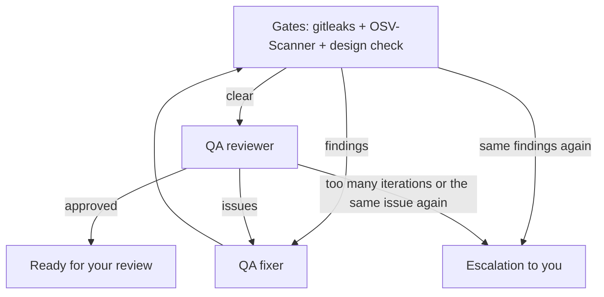

# How a task goes through the pipeline

## Specification — depth depends on complexity

First, the **complexity assessor** determines the task's level:

| Level | Phases |
|---|---|
| **Simple** | quick spec → validation |
| **Standard** | discovery → requirements → spec → plan → validation |
| **Complex** | discovery → requirements → research → context → spec → self-critique → **architecture** → plan → validation |

What happens in each phase:
- **Discovery / context:** the agents study the existing code so the spec matches the real project.
- **Research:** libraries and APIs are checked against current documentation (Context7).
- **Self-critique:** a separate agent looks for holes in the spec.
- **Architecture:** for complex tasks by default. The architect writes `architecture.md`, ADRs and diagrams before the planner; simple and standard tasks are planned from the spec alone. The **Architect** option in Settings → Agent Settings changes this: *every task* (the architect designs before the planner in every tier; a simple task gets a planner session after the quick spec so the plan follows the design), *complex tasks only* (default) or *never*.
- **Validation:** a check that the spec and plan are consistent and ready for work.

## Spec-driven + test-first

- Each acceptance criterion has an ID (`AC-n`) and a test level.
- A plan subtask says which test to write first and which ACs it covers.
- The coder works in a red → green → refactor loop and commits each subtask.
- QA builds a table "AC → test → does it actually verify it → result". If an AC has no test, the test verifies nothing, or it fails, that is an issue, and QA will not approve the work.

## The QA loop

- The review runs only when the checks are clear: findings go straight to the fixer, which gets one round at each. If the same finding is back, the task comes to you at once. In Review you can allow a design finding the design system permits, then run QA again.
- The app writes a `qa_report.md` report (with the AC table) and a manual test plan.
- Dev servers run through the app: agents ask for one and get its URL. It gets a free port, is reused by later sessions of the task and stops with the task, along with the containers the task started (`docker compose up` brings those back with their data).
- The first review is a full one. A later one in the same run looks at what changed since the last: the earlier issues, the changed code and the acceptance criteria it touches, plus one whole test run.
- A QA run has at most 2 review rounds: when the first review rejects, the fixer gets one round, and if the second review still rejects, the task goes to you for review.
- The QA fixer edits code like the coder, so it runs on the Coding model and thinking level from your agent profile, not the QA ones; its logs still appear in the QA phase.
- If the same problem comes back in three rounds, counting rounds of earlier QA runs, the task is escalated to you at once.

## Strix (Security QA)

An optional pentest after QA approval. You enable it in Settings → Agent Settings; it needs Docker and a key. Strix starts a container, attacks the changed code and returns findings. They appear in Workspace → Security, and the QA fixer fixes them. If Docker, Strix or the key is missing, the step is skipped and nothing fails. You can follow progress in the review phase logs (there is a heartbeat once a minute).

## Stop, recovery, queue

- **Stop** stops the agents. If a plan already exists, the task goes to your review (Human Review); if not, back to Planning.
- **An earlier approval:** a run skips QA only if the app itself recorded an approval for exactly this code (commit and uncommitted changes). The verdict in `implementation_plan.json` alone isn't enough, and neither is an approval for code that has changed since.
- **Turn limit:** a coder session may take up to 120 turns (planner and architect 120, QA 200). A subtask that reaches it isn't counted as done: a new session continues it, up to 3 attempts, and then the build stops and names the subtask. A QA reviewer stopped at the limit can still report the problems it found, but it can't approve: without problems, the review runs again. The task window shows these sessions.
- **Recovery:** on startup the app finds subtasks that got stuck and puts them back into work. There is a separate coder recovery prompt for failures.
- **Queue:** when there is a free slot within the limit on parallel tasks, queued tasks start on their own.
