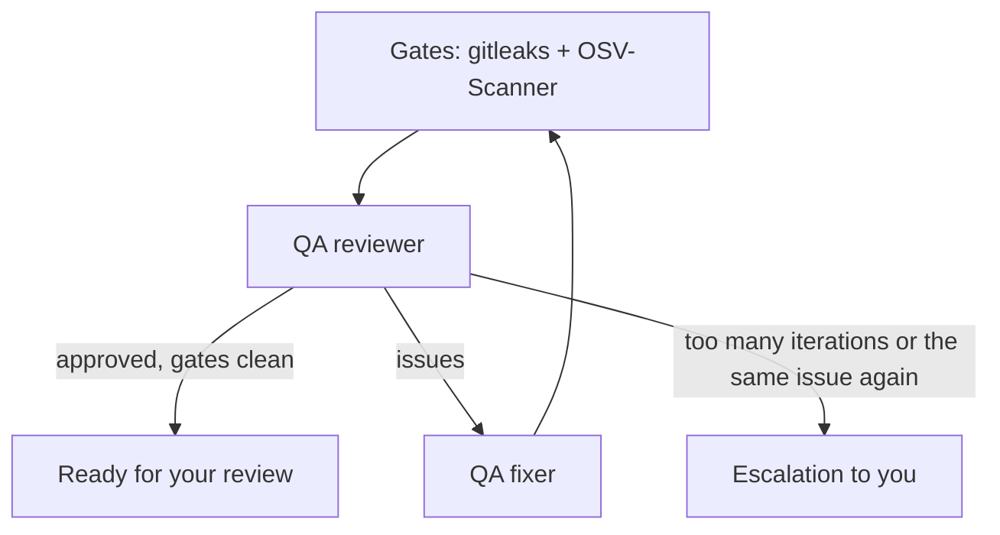

# How a task goes through the pipeline

## Specification — depth depends on complexity

First, the **complexity assessor** determines the task's level:

| Level | Phases |
|---|---|
| **Simple** | quick spec → validation |
| **Standard** | discovery → requirements → spec → **architecture** → plan → validation |
| **Complex** | discovery → requirements → research → context → spec → self-critique → **architecture** → plan → validation |

What happens in each phase:
- **Discovery / context:** the agents study the existing code so the spec matches the real project.
- **Research:** libraries and APIs are checked against current documentation (Context7).
- **Self-critique:** a separate agent looks for holes in the spec.
- **Validation:** a check that the spec and plan are consistent and ready for work.

## Spec-driven + test-first

- Each acceptance criterion has an ID (`AC-n`) and a test level.
- A plan subtask says which test to write first and which ACs it covers.
- The coder works in a red → green → refactor loop and commits each subtask.
- QA builds a table "AC → test → does it actually verify it → result". If an AC has no test, the test verifies nothing, or it fails, that is an issue, and QA will not approve the work.

## The QA loop

- Gate findings block approval, even if the reviewer said "ok".
- The app writes a `qa_report.md` report (with the AC table) and a manual test plan.
- If the same problem repeats over several iterations, the task is escalated to you.

## Strix (Security QA)

An optional pentest after QA approval. You enable it in Settings → Agent Settings; it needs Docker and a key. Strix starts a container, attacks the changed code and returns findings. They appear in Workspace → Security, and the QA fixer fixes them. If Docker, Strix or the key is missing, the step is skipped and nothing fails. You can follow progress in the review phase logs (there is a heartbeat once a minute).

## Stop, recovery, queue

- **Stop** stops the agents. If a plan already exists, the task goes to your review (Human Review); if not, back to Planning.
- **Recovery:** on startup the app finds subtasks that got stuck and puts them back into work. There is a separate coder recovery prompt for failures.
- **Queue:** when there is a free slot within the limit on parallel tasks, queued tasks start on their own.
