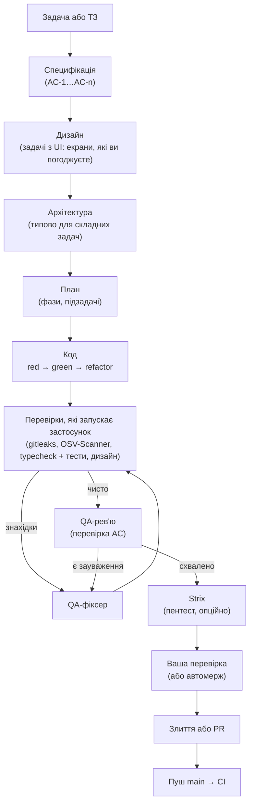

# Що таке Vibe Teamlead

Vibe Teamlead — настільний застосунок для macOS і Windows (бета), у якому команда AI-агентів на Claude Code будує софт за специфікацією. Ви описуєте задачу або завантажуєте ТЗ, а агенти проходять шлях, як справжня команда: аналітик → архітектор → планувальник → розробник (спершу тест) → QA → перевірка безпеки → ваше рішення про злиття. Ви бачите роботу наживо й відповідаєте на питання агентів, коли рішення за вами.

## Шлях задачі коротко

1. **Ви створюєте задачу** (кнопка «Створити» → «Нова задача») або **завантажуєте ТЗ** (`.docx`, `.md`, `.pdf`, `.txt`; `.rtf` лише на macOS). Спершу аналітик ТЗ читає документ і проєкт і по одному питанню уточнює те, що лишилось відкритим, як це робить скіл brainstorming із Superpowers. Кожне питання пояснює, що зміниться від відповіді, і пропонує рекомендований варіант. Ви завжди можете написати свою відповідь, пропустити питання або натиснути «Досить питань, пропонуй задачі». До детального ТЗ буде одне-два питання, до кількох речень — більше. Потім аналітик розбиває документ на епіки й задачі з урахуванням ваших відповідей. Він покриває весь документ, хоч який великий: ніколи лише першу фазу чи MVP, і кожна задача будує свої вимоги так, як вони записані. Фази й пріоритети документа задають порядок задач, а не те, що лишиться поза ними; вилучити щось можуть лише ваші слова (у документі або у відповіді). Великий документ розбивається частинами приблизно по 25 задач, і аналітика питають про наступну частину, доки нічого не лишиться. Застосунок перевіряє це сам: знаходить у документі нумеровані вимоги (FR-12, NFR-03) і звіряє їх із задачами. Якщо щось лишилося без задачі, крок перегляду каже про це першим, у блоці **Не весь документ**, і окремо показує те, що вилучено навмисно. Крок перегляду показує ваші відповіді, припущення аналітика й питання, що лишились, і задачі можна виправити, перш ніж створювати. Перемикач «Спершу поставити мені питання» поруч із «Аналізувати» вимикає питання. Кожне питання, що лишилось, називає задачі, яких воно стосується. Воно потрапляє в опис цих задач, і їхній агент специфікації ставить його, коли задача стартує, якщо відповіді ще немає: кожна ваша відповідь агенту задачі з ТЗ зберігається разом із документом (`clarifications.md`), і інші задачі читають її звідти. Питання щодо окремої задачі ставить пізніше специфікатор, коли задача стартує.
2. **Специфікація.** Агенти збирають вимоги й пишуть `spec.md` з критеріями приймання `AC-1…AC-n`. Кожен критерій має рівень тесту: unit, integration або e2e.
   Для задачі, що змінює інтерфейс, далі дизайнер малює її екрани (wireframe, потім дизайн), а ви затверджуєте їх на вкладці Design задачі до плану (див. «Дизайн перед кодом»).
3. **Архітектура** (типово лише для складних задач; налаштування **«Архітектор»** вмикає її для кожної задачі або вимикає). Архітектор пише `architecture.md`, рішення у форматі ADR, діаграми draw.io та Mermaid. Кожну діаграму він рендерить і виправляє, поки вона не стане чистою.
4. **План.** Планувальник розбиває роботу на фази й підзадачі. У кожної підзадачі вказано, які AC вона закриває і який тест має впасти першим.
5. **Код.** Кодер працює в ізольованій копії репозиторію (git worktree) за TDD: спершу тест, що падає, потім код, потім рефакторинг. Після кожної підзадачі — коміт.
6. **QA.** Спершу жорсткі гейти: gitleaks (секрети), OSV-Scanner (вразливі залежності) та Semgrep, якщо його встановлено. Застосунок також сам запускає перевірку типів і тести проєкту. Потім QA-рев'юер перевіряє, що кожен AC має тест, який справді його доводить, переглядає змінений код, перевіряє UI в браузері й пише звіт. Сам він запускає лише ті перевірки, які застосунок не зміг запустити. Якщо є зауваження, QA-фіксер виправляє, і QA повторюється.
7. **Strix** (якщо увімкнено): пентест зміненого коду в Docker.
8. **Ваша перевірка.** Ви переглядаєте зміни у Workspace задачі й вирішуєте: злити в основну гілку, створити PR або відкинути.

Поки агент працює, він може **поставити вам питання** (наприклад, «JWT чи серверні сесії?»). Праворуч з'являється панель із варіантами, і агент чекає на вашу відповідь. Можна пропустити питання — тоді агент вирішить сам і запише своє припущення.
