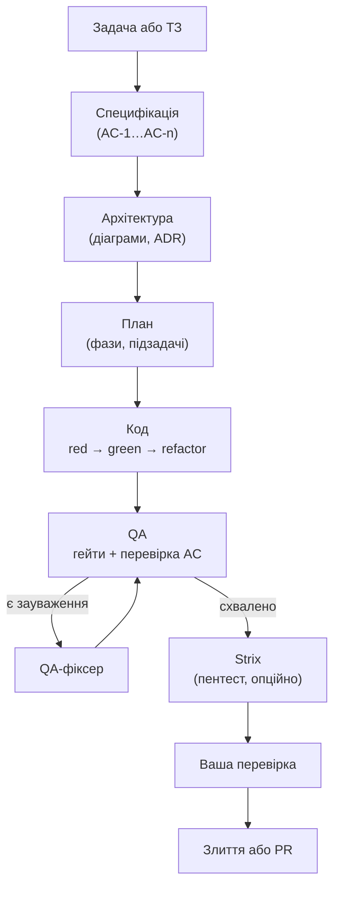

# Що таке Vibe Teamlead

Vibe Teamlead — застосунок для macOS, у якому команда AI-агентів на Claude Code будує софт за специфікацією. Ви описуєте задачу або завантажуєте ТЗ, а агенти проходять шлях, як справжня команда: аналітик → архітектор → планувальник → розробник (спершу тест) → QA → перевірка безпеки → ваше рішення про злиття. Ви бачите роботу наживо й відповідаєте на питання агентів, коли рішення за вами.

## Шлях задачі коротко

1. **Ви створюєте задачу** (кнопка «Створити» → «Нова задача») або **завантажуєте ТЗ** (`.docx`, `.md`, `.pdf`, `.txt`, `.rtf`). Аналітик ТЗ розбиває документ на окремі задачі.
2. **Специфікація.** Агенти збирають вимоги й пишуть `spec.md` з критеріями приймання `AC-1…AC-n`. Кожен критерій має рівень тесту: unit, integration або e2e.
3. **Архітектура** (для задач середньої та високої складності). Архітектор пише `architecture.md`, рішення у форматі ADR, діаграми draw.io та Mermaid. Кожну діаграму він рендерить і виправляє, поки вона не стане чистою.
4. **План.** Планувальник розбиває роботу на фази й підзадачі. У кожної підзадачі вказано, які AC вона закриває і який тест має впасти першим.
5. **Код.** Кодер працює в ізольованій копії репозиторію (git worktree) за TDD: спершу тест, що падає, потім код, потім рефакторинг. Після кожної підзадачі — коміт.
6. **QA.** Спершу жорсткі гейти: gitleaks (секрети) та OSV-Scanner (вразливі залежності). Потім QA-рев'юер звіряє кожен AC з тестом, запускає тести, перевіряє UI в браузері й пише звіт. Якщо є зауваження, QA-фіксер виправляє, і QA повторюється.
7. **Strix** (якщо увімкнено): пентест зміненого коду в Docker.
8. **Ваша перевірка.** Ви переглядаєте зміни у Workspace задачі й вирішуєте: злити в основну гілку, створити PR або відкинути.

Поки агент працює, він може **поставити вам питання** (наприклад, «JWT чи серверні сесії?»). Праворуч з'являється панель із варіантами, і агент чекає на вашу відповідь. Можна пропустити питання — тоді агент вирішить сам і запише своє припущення.
