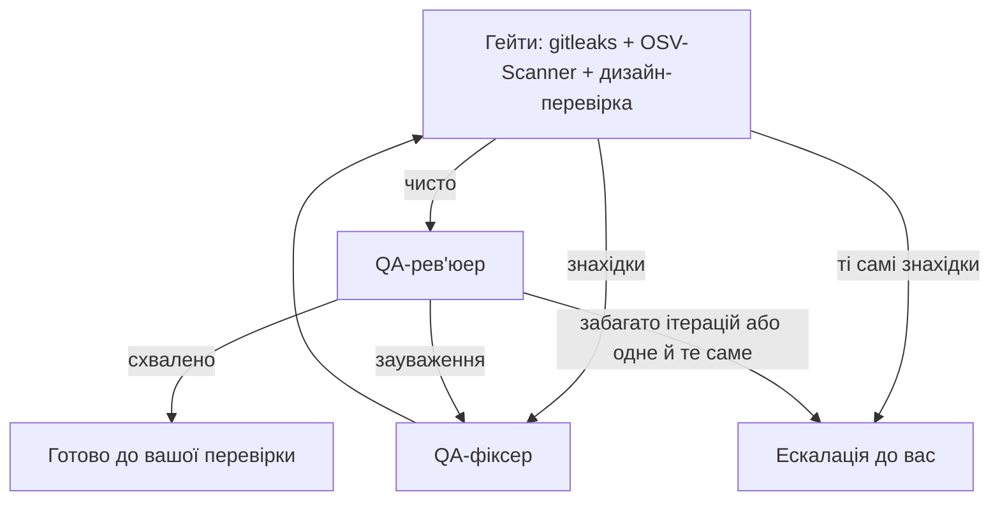

# Як задача проходить конвеєр

## Специфікація — глибина залежить від складності

Спершу **оцінювач складності** визначає рівень задачі:

| Рівень | Фази |
|---|---|
| **Простий** | швидка спека → валідація |
| **Середній** | discovery → вимоги → спека → план → валідація |
| **Складний** | discovery → вимоги → дослідження → контекст → спека → самокритика → **архітектура** → план → валідація |

Що відбувається на кожній фазі:
- **Discovery / контекст:** агенти вивчають наявний код, щоб спека відповідала реальному проєкту.
- **Дослідження:** перевірка бібліотек і API за актуальною документацією (Context7).
- **Самокритика:** окремий агент шукає дірки в спеці.
- **Архітектура:** лише для складних задач. Архітектор пише `architecture.md`, ADR і діаграми перед планувальником; задачі середньої складності плануються лише за спекою.
- **Валідація:** перевірка, що спека й план узгоджені й готові до роботи.

## Spec-driven + test-first

- У кожного критерію приймання є ID (`AC-n`) і рівень тесту.
- Підзадача плану каже, який тест написати першим і які AC вона закриває.
- Кодер працює циклом red → green → refactor і комітить кожну підзадачу.
- QA будує таблицю «AC → тест → чи справді перевіряє → результат». Якщо для AC немає тесту, тест нічого не перевіряє або падає, це зауваження, і QA не схвалить роботу.

## Цикл QA

- Рев'ю запускається лише тоді, коли перевірки чисті: знахідки одразу йдуть до фіксера, який має один раунд на кожну. Якщо та сама знахідка повернулась, задача одразу приходить до вас. У Review можна дозволити дизайн-знахідку, яку дизайн-система допускає, і запустити QA ще раз.
- Застосунок пише звіт `qa_report.md` (з таблицею AC) і план ручного тестування.
- Dev-сервери запускає застосунок: агент просить сервер і отримує його URL. Сервер отримує вільний порт, ним користуються наступні сесії задачі, і він зупиняється разом із задачею, як і контейнери, які вона запустила (`docker compose up` повертає їх разом із даними).
- Перше рев'ю повне. Наступні в межах того самого запуску дивляться на те, що змінилось: попередні зауваження, змінений код і зачеплені критерії приймання, плюс один повний прогін тестів.
- У запуску QA щонайбільше 2 раунди рев'ю: якщо перше рев'ю відхилило роботу, фіксер має один раунд, а якщо друге рев'ю знову відхиляє, задача йде до вас на перевірку.
- QA-фіксер редагує код так само, як кодер, тому працює на моделі й рівні «мислення» фази «Код» з вашого профілю агентів, а не QA; його логи залишаються у фазі QA.
- Якщо та сама проблема повертається у трьох раундах, зокрема з попередніх запусків QA, задача одразу ескалюється до вас.

## Strix (Security QA)

Опційний пентест після схвалення QA. Він вмикається в «Налаштування → Агенти», потрібні Docker і ключ. Strix піднімає контейнер, атакує змінений код і віддає знахідки. Вони з'являються у Workspace → Security, а QA-фіксер їх виправляє. Якщо Docker, Strix або ключа немає, крок пропускається і нічого не падає. Хід роботи видно в логах фази перевірки (там є серцебиття раз на хвилину).

## Зупинка, відновлення, черга

- **«Зупинити»** зупиняє агентів. Якщо план уже є, задача йде на вашу перевірку, якщо ні — назад у планування.
- **Попереднє схвалення:** запуск пропускає QA, лише якщо застосунок сам записав схвалення саме для цього коду (коміт і незакомічені зміни). Самого вердикту в `implementation_plan.json` недостатньо, як і схвалення для коду, який відтоді змінився.
- **Ліміт ходів:** сесія кодера може тривати до 120 ходів (планувальник і архітектор 120, QA 200). Підзадача, яка вперлась у ліміт, не вважається виконаною: її продовжує нова сесія, до 3 спроб, а потім збірка зупиняється й називає підзадачу. Рев'юер QA, зупинений лімітом, ще може повідомити про знайдені проблеми, але не може схвалити: якщо проблем немає, рев'ю повторюється. Вікно задачі показує такі сесії.
- **Відновлення:** при старті застосунок знаходить підзадачі, що «застрягли», і повертає їх у роботу. Для збоїв є окремий промпт відновлення кодера.
- **Черга:** коли є вільне місце за лімітом паралельних задач, задачі з черги стартують самі.
