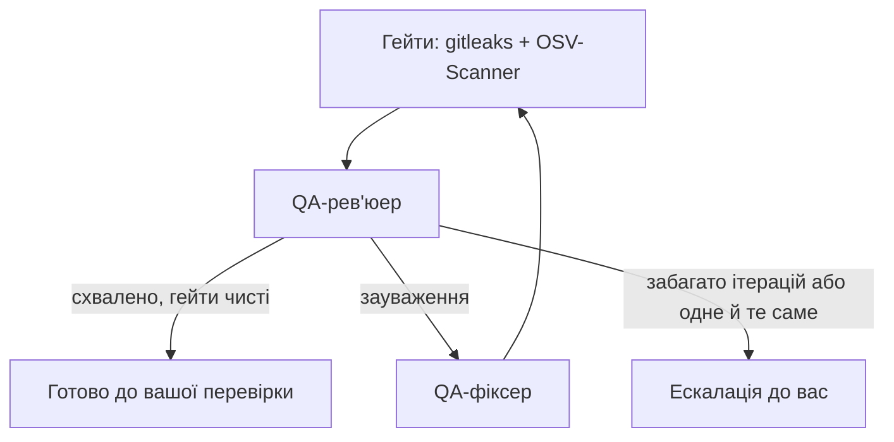

# Як задача проходить конвеєр

## Специфікація — глибина залежить від складності

Спершу **оцінювач складності** визначає рівень задачі:

| Рівень | Фази |
|---|---|
| **Простий** | швидка спека → валідація |
| **Середній** | discovery → вимоги → спека → **архітектура** → план → валідація |
| **Складний** | discovery → вимоги → дослідження → контекст → спека → самокритика → **архітектура** → план → валідація |

Що відбувається на кожній фазі:
- **Discovery / контекст:** агенти вивчають наявний код, щоб спека відповідала реальному проєкту.
- **Дослідження:** перевірка бібліотек і API за актуальною документацією (Context7).
- **Самокритика:** окремий агент шукає дірки в спеці.
- **Валідація:** перевірка, що спека й план узгоджені й готові до роботи.

## Spec-driven + test-first

- У кожного критерію приймання є ID (`AC-n`) і рівень тесту.
- Підзадача плану каже, який тест написати першим і які AC вона закриває.
- Кодер працює циклом red → green → refactor і комітить кожну підзадачу.
- QA будує таблицю «AC → тест → чи справді перевіряє → результат». Якщо для AC немає тесту, тест нічого не перевіряє або падає, це зауваження, і QA не схвалить роботу.

## Цикл QA

- Знахідки гейтів блокують схвалення, навіть якщо рев'юер сказав «ок».
- Застосунок пише звіт `qa_report.md` (з таблицею AC) і план ручного тестування.
- Якщо одна проблема повторюється кілька ітерацій, задача ескалюється до вас.

## Strix (Security QA)

Опційний пентест після схвалення QA. Він вмикається в «Налаштування → Агенти», потрібні Docker і ключ. Strix піднімає контейнер, атакує змінений код і віддає знахідки. Вони з'являються у Workspace → Security, а QA-фіксер їх виправляє. Якщо Docker, Strix або ключа немає, крок пропускається і нічого не падає. Хід роботи видно в логах фази перевірки (там є серцебиття раз на хвилину).

## Зупинка, відновлення, черга

- **«Зупинити»** зупиняє агентів. Якщо план уже є, задача йде на вашу перевірку, якщо ні — назад у планування.
- **Відновлення:** при старті застосунок знаходить підзадачі, що «застрягли», і повертає їх у роботу. Для збоїв є окремий промпт відновлення кодера.
- **Черга:** коли є вільне місце за лімітом паралельних задач, задачі з черги стартують самі.
