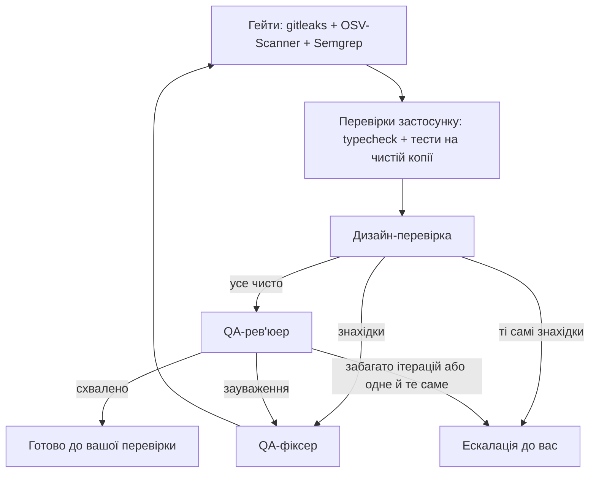

# Як задача проходить конвеєр

## Яким конвеєром іде задача

Не кожній задачі потрібна вся команда. Задача йде одним із трьох конвеєрів:

| Конвеєр | Що працює | Для чого |
|---|---|---|
| **Повний** | специфікація → дизайн → архітектура → план → код → QA → ваша перевірка | Те, що описує решта цієї сторінки. |
| **Короткий** | коротка специфікація з критеріями приймання та її план → код → QA → ваша перевірка | Зрозуміла, обмежена робота. Без дизайнера й архітектора. |
| **Одна сесія** | один агент пише критерії приймання, тести й код → перевірки застосунку та сканери → ваша перевірка | Невелика самодостатня річ: маленька гра, скрипт, дрібна зміна. |

- **Обираєте ви** у формі задачі (**Конвеєр**), коли створюєте або редагуєте задачу. Ваш вибір завжди головний. Він діє на старті задачі: зміна пізніше не переплановує задачу, яка вже має план.
- **Значення проєкту за замовчуванням.** Налаштування → Проєкт → Черга → **Конвеєр для задач** задає конвеєр кожної задачі, яка не обрала свого, зокрема задач із документа-специфікації. Форма задачі тоді пропонує **Як у проєкті**, а **Авто** лишається для задачі, де має вирішити сам застосунок. Значення не діє на задачі, які проєктує архітектор, швидкі виправлення з попереднього перегляду та задачі, які застосунок створює, щоб полагодити main: вони зберігають свій конвеєр.
- **Авто** (задача без вибору в проєкті без значення за замовчуванням) вирішує на старті задачі, не зупиняючись, щоб спитати.
  - Спершу за тим, що це за задача: задача, яку проєктує архітектор, іде повним конвеєром; швидке виправлення з попереднього перегляду і задача, яку застосунок створив, щоб полагодити main, ідуть коротким. За словами в тексті задачі нічого не вирішується.
  - Для будь-якої іншої задачі, зокрема з документа-специфікації, оцінювач складності читає її, обирає й пише чому. Задача, яку він вважає складною, завжди йде повним, як і задача, що змінює вхід чи доступ, гроші, персональні дані або схему бази даних.
- **Задача це показує.** Рядок «Конвеєр» у вікні задачі має лише етапи конвеєра цієї задачі та рядок про те, який це конвеєр і чому. Позначки на картці відповідають.
- **Легшою задачу робите тільки ви.** Пізніше автоматичне рішення для тієї самої задачі може лише лишити її як є або зробити важчою.
- **Одна сесія тримається правил.** Спершу критерії приймання з ідентифікаторами, потім тест, що падає, для кожного, потім код. Власні перевірки застосунку та сканери безпеки працюють, як для будь-якої задачі, і блокують так само, а фіксер виправляє те, що вони знайшли. QA-рев'юера немає, тому застосунок не записує схвалення QA і **задача ніколи не зливається сама**, хоч що каже автозлиття черги: вона чекає вашої перевірки. У вікні задачі її етап QA називається **Перевірки**.
- **Короткий конвеєр** використовує швидку специфікацію (специфікація та її план за одну сесію). У ньому немає дизайнера навіть для задачі з UI і немає архітектора, хоч що каже налаштування «Архітектор». QA в ньому звичайний.
- **Коли однієї сесії замало.** Якщо агент тричі досягає ліміту ходів і не закінчує, задача сама йде далі коротким конвеєром, а зроблене зберігається: планувальник читає вже збудоване і планує решту підзадачами, кодери їх будують, а QA-рев'юер перевіряє результат. Рядок про конвеєр у задачі це показує. Це стосується й задачі, яку ви самі поставили на одну сесію. Якщо агент сам зупиняється й пише чому (рішення, яке належить вам), задача чекає на вас, як і раніше.

## Специфікація — глибина залежить від складності

Спершу **оцінювач складності** визначає рівень задачі:

| Рівень | Фази |
|---|---|
| **Простий** | швидка спека → валідація |
| **Середній** | discovery → вимоги → спека → план → валідація |
| **Складний** | discovery → вимоги → дослідження → контекст → спека → самокритика → **архітектура** → план → валідація |

Що відбувається на кожній фазі:
- **Discovery / контекст:** агенти вивчають наявний код, щоб спека відповідала реальному проєкту.
- **Дослідження:** перевірка бібліотек і API за актуальною документацією (Context7).
- **Самокритика:** окремий агент шукає дірки в спеці.
- **Архітектура:** типово лише для складних задач. Архітектор пише `architecture.md`, ADR і діаграми перед планувальником; прості й середні задачі плануються лише за спекою. Це змінює опція **«Архітектор»** у Налаштуваннях → Агенти: *для кожної задачі* (архітектор проєктує перед планувальником на будь-якому рівні; проста задача після швидкої спеки отримує сесію планувальника, щоб план відповідав дизайну), *лише для складних задач* (типово) або *ніколи*.
- **Дизайн:** для задачі, що змінює UI, одразу після спеки дизайнер малює wireframe і екрани, а план іде після дизайну. Архітектура й план такої задачі йдуть після дизайну (див. «Дизайн перед кодом»).
- **Валідація:** перевірка, що спека й план узгоджені й готові до роботи.

## Spec-driven + test-first

- У кожного критерію приймання є ID (`AC-n`) і рівень тесту.
- Підзадача плану каже, який тест написати першим і які AC вона закриває.
- Кодер працює циклом red → green → refactor і комітить кожну підзадачу. Кожна підзадача отримує окрему сесію з чистим контекстом, своїми спогадами й навичками; її перше повідомлення містить запис підзадачі з плану, критерії приймання, які вона називає, і файли, які вона називає, знайдені застосунком: малі файли цілими, великі як карту CodeGraph з їхніми символами, номерами рядків і файлами, що ними користуються (у журналі задачі видно, що саме було дано). Весь план чи спеку агент відкриває лише тоді, коли йому потрібно більше.
- Після кожного файлу, який записує кодер (або QA-фіксер), на ньому запускаються власні форматер і лінтер проєкту (prettier/ESLint або Biome з `node_modules` проєкту, ruff з його venv або, коли у venv його нема, з вашого PATH, gofmt/go vet з вашого PATH), і знахідки одразу повертаються агенту, тож він виправляє їх відразу, а не запускає весь лінт чи витрачає на це раунд QA. Нічого не встановлюється: проєкт без такого інструмента перевірки не отримує. Перемикач — у «Налаштування → Агенти».
- QA будує таблицю «AC → тест → чи справді перевіряє → результат». Якщо для AC немає тесту, тест нічого не перевіряє або падає, це зауваження, і QA не схвалить роботу.

## Цикл QA

- Перевірки — це gitleaks (секрети), OSV-Scanner (вразливі залежності), Semgrep (статичний аналіз змінених файлів правилами його реєстру, рівень ERROR; працює лише якщо Semgrep встановлено на вашому комп’ютері: `brew install semgrep` на macOS, `pip install semgrep` на Windows (пакета winget у Semgrep немає) чи будь-де з Python; інакше або коли правила не вдається завантажити — пропускається) і дизайн-перевірка. Рев'юеру сказано не повторювати ці сканування вручну, а шукати те, чого вони не бачать: авторизацію, ізоляцію тенантів, межі довіри.
- Рев'ю запускається лише тоді, коли перевірки чисті: знахідки одразу йдуть до фіксера, який має один раунд на кожну, а на перевірку проєкту, яку задача зламала (її тести чи збірку), два. Якщо та сама знахідка повертається й після цього, задача приходить до вас. Фіксер спершу бачить, який пакет упав, і рядки з помилкою, а не лише кінець виводу. У Review можна дозволити дизайн-знахідку, яку дизайн-система допускає, і запустити QA ще раз.
- Застосунок пише звіт `qa_report.md` (з таблицею AC) і план ручного тестування.
- Dev-сервери запускає застосунок: агент просить сервер і отримує його URL. Сервер отримує вільний порт, ним користуються наступні сесії задачі, і він зупиняється разом із задачею, як і контейнери, які вона запустила (`docker compose up` повертає їх разом із даними).
- Браузерні інструменти (Playwright, Chrome DevTools, Electron MCP) запускаються для рев'юера й фіксера лише тоді, коли задача змінила UI-файли; для суто бекендових змін вони вимкнені, і рев'ю перевіряє поведінку тестами й кодом.
- Перше рев'ю повне. Наступні в межах того самого запуску дивляться на те, що змінилось: попередні зауваження, змінений код і зачеплені критерії приймання, плюс один повний прогін тестів.
- У запуску QA щонайбільше 2 раунди рев'ю: якщо перше рев'ю відхилило роботу, фіксер має один раунд, а якщо друге рев'ю знову відхиляє, задача йде до вас на перевірку.
- QA-фіксер редагує код так само, як кодер, тому працює на моделі й рівні «мислення» фази «Код» з вашого профілю агентів, а не QA; його логи залишаються у фазі QA.
- Якщо та сама проблема повертається у трьох раундах, зокрема з попередніх запусків QA, задача одразу ескалюється до вас.

## Діаграми хмарної архітектури (TerraVision, експериментально)

Необов'язкове доповнення до власних діаграм архітектора, типово вимкнене: увімкніть його в «Налаштування → Агенти» → **Діаграми хмарної архітектури** і встановіть uv і Graphviz (а для малювання з коду ще Terraform або OpenTofu). Застосунок їх не вбудовує. Поки його вимкнено, Context → **Архітектура** каже про це й має кнопку до цього налаштування, кнопка проєктування неактивна, а список рішень лишається. Воно використовує [TerraVision](https://github.com/patrickchugh/terravision) (AGPL-3.0), щоб малювати архітектуру AWS, Azure і Google Cloud з їхніми офіційними іконками. Звичайних задач це не стосується: жодного додаткового інструмента, тексту в промпті чи токенів.

**Два моменти:**

- **Спроєктовано (архітектор).** Коли задача стосується хмарної інфраструктури (специфікація називає хмару, Terraform, VPC, Kubernetes тощо; або в проєкті є Terraform, а специфікація говорить про розгортання чи інфраструктуру), архітектор також отримує TerraVision. Він описує цільову хмарну архітектуру як граф і рендерить її (SVG, PNG, draw.io і граф як `.tvg.json`) у папку діаграм специфікації, поруч з іншими діаграмами. Вона видна на вкладці Workspace → Architecture задачі. Архітектор може лише малювати граф: він не може змусити TerraVision запустити Terraform, відкрити чи прочитати файли. З агентним режимом специфікації архітектор не є сабагентом специфікації: він працює на початку збірки як окрема сесія і так само отримує TerraVision.
- **З коду (без моделі).** Після злиття, що змінило файли `.tf`, `.tofu` або `.tfvars`, застосунок сам перемальовує архітектуру з коду Terraform: на чистій копії злитого коміту, без API-ключів, без хмарних облікових даних і входів (власна порожня домашня папка), з обмеженням часу і ніколи не `apply`. У TerraVision немає статичного режиму: малювання з коду запускає `terraform init` (завантажує провайдери з публічного реєстру: мережа) і `terraform plan` на власному коді проєкту, без доступу до хмари. Тому код спершу перевіряється, і застосунок відмовляється його планувати, з простою приміткою, коли в ньому є provisioner, джерело даних чи ресурс провайдера поза перевіреним списком (aws, azurerm, azuread, google, google-beta, random, tls, time; тож без `external`, `local_file` чи `http`), налаштування провайдера, що називає файл, процес чи токен, модуль, що не є папкою репозиторію (модулі з реєстру й віддалені запускалися б неперевіреними), файлова функція на шляху поза репозиторієм, Terraform JSON, символьне посилання або щось, чого перевірка не може прочитати. Якщо plan потребує хмарних облікових даних, їх не дають: примітка каже, що намалювати з коду без доступу до хмари не вдалося. Результат (SVG, draw.io, інтерактивна HTML-сторінка і граф) зберігається в `.vibe-teamlead/cloud-architecture/`.

**Де дивитися:** Context → **Архітектура** показує останню спроєктовану діаграму і останню намальовану з коду поруч, з якого коміту і злитої задачі вона, кнопки, щоб відкрити файл draw.io, SVG та інтерактивну сторінку, і рішення (ADR) злитих задач, найновіші першими, кожне відкриває свою задачу. Кнопка **Спроєктувати хмарну архітектуру** там створює задачу в Плануванні для архітектора: прочитати проєкт, триматися хмари, на яку він уже вказує, намалювати цільову архітектуру й написати ADR, не змінюючи коду. Нічого не запускається, доки ви її не почнете; запуск починає сесії специфікації та архітектора (виклики моделі). Задача закінчується після архітектора: вона лише про архітектуру, тож планувальник, кодер, QA, перевірки застосунку і злиття не запускаються. Вона чекає в Human Review зі статусом **Архітектура готова**: її вкладка «Архітектура» показує діаграми й ADR, спроєктована діаграма з'являється в Context → **Архітектура**, а ви позначаєте задачу виконаною (зливати нічого: файли лишаються в теці специфікації задачі). Її ADR з'являються в списку, щойно вона виконана.

**Вимоги** (не вбудовані, застосунок їх не встановлює; рядок у налаштуваннях каже, чого бракує): [uv](https://docs.astral.sh/uv/) (запускає закріплений реліз TerraVision; `brew install uv`, `winget install --id astral-sh.uv -e`) або встановлений `terravision`; Graphviz (`brew install graphviz`, `winget install --id Graphviz.Graphviz -e`); Git; і для малювання з коду Terraform або OpenTofu (`brew install opentofu`, `winget install --id OpenTofu.Tofu -e`). Перший запуск завантажує TerraVision і його Python. Коли чогось бракує, нічого не малюється і нічого не ламається.

## Strix (Security QA)

Опційний пентест після схвалення QA. Він вмикається в «Налаштування → Агенти», потрібні Docker і модель: API-ключ Claude агентів або власний провайдер і ключ (див. «Модель для Strix» у «Якість і безпека»). Strix піднімає контейнер, атакує змінений код і віддає знахідки. Він працює з одноразовою копією задачі без ігнорованих файлів, як-от `.env`, тому тека задачі лишається такою, якою її схвалив QA. Знахідки з'являються у Workspace → Security, а QA-фіксер їх виправляє. Якщо пентест зупинився раніше, задача лишається схваленою, а її картка й екран задачі повідомляють про це та називають причину. Якщо немає Docker, Strix або ключа моделі (чи агенти працюють на підписці Claude, а іншого провайдера не вибрано), крок пропускається, причина пояснює чому, і нічого не падає. Хід роботи видно в логах фази перевірки (там є серцебиття раз на хвилину).

## Зупинка, відновлення, черга

- **«Зупинити»** зупиняє агентів. Якщо план уже є, задача йде на вашу перевірку, якщо ні — назад у планування.
- **Попереднє схвалення:** запуск пропускає QA, лише якщо застосунок сам записав схвалення саме для цього коду (коміт і незакомічені зміни). Самого вердикту в `implementation_plan.json` недостатньо, як і схвалення для коду, який відтоді змінився.
- **Ліміт ходів:** сесія кодера може тривати до 120 ходів (планувальник і архітектор 120, QA 200, дизайнер 80). Підзадача, яка вперлась у ліміт, не вважається виконаною: її продовжує нова сесія, до 3 спроб, а потім збірка зупиняється й називає підзадачу. Рев'юер QA, зупинений лімітом, ще може повідомити про знайдені проблеми, але не може схвалити: якщо проблем немає, рев'ю повторюється. Вікно задачі показує такі сесії.
- **Відновлення:** задачі, що працювали, коли застосунок закрився (або впав), при наступному запуску зупиняються так само, як кнопкою «Стоп»: задача з планом чекає на перевірці з кнопкою «Продовжити», без плану повертається в беклог. Сам нічого не перезапускається. Після «Продовжити» недороблені підзадачі повертаються в роботу. Для збоїв є окремий промпт відновлення кодера.
- **Черга:** задача займає місце від старту до мержу, архівації чи видалення, тож наступна стартує від `main`, де ця робота вже є. За замовчуванням одна задача за раз; у «Налаштування → Проєкт → Черга» можна до трьох, але це може спричиняти конфлікти. Задачі з черги стартують самі, коли є вільне місце, хоч який екран відкрито; збільшений ліміт запускає їх одразу. Чергу можна призупинити з Telegram (`/stop_all`; `/resume` запускає її знову): тоді жодна задача з черги не стартує.
- **Автомерж:** вмикається в «Налаштування → Проєкт → Черга», за замовчуванням вимкнений. Задача вливається сама, якщо QA її схвалив, а перевірки застосунку й Security QA чисті. Це стається, коли задача доходить до перевірки: коли ви вмикаєте автомерж, задачі, які QA вже схвалив і які чекають на перевірку, показуються списком і вливаються, лише якщо ви погодитеся. Задачі, які створює сам «CI» (перешкоди готовності й виправлення невдалого запуску в main), зливаються самі після QA, навіть коли автомерж вимкнено (див. «CI»). Усе інше лишається за вами, а мерж, для якого агент змінив код, чекає вашого перегляду. З увімкненим **UI-задачі чекають мого перегляду** задача, що змінила інтерфейс, чекає, поки ви подивитеся її у вкладці «Перегляд» (див. «Перегляд»).
- **Перегляд:** після мержу застосунок із main видно просто у вікні, у «Перегляді» в сайдбарі (див. «Перегляд»).
