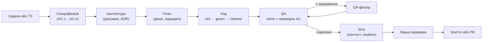
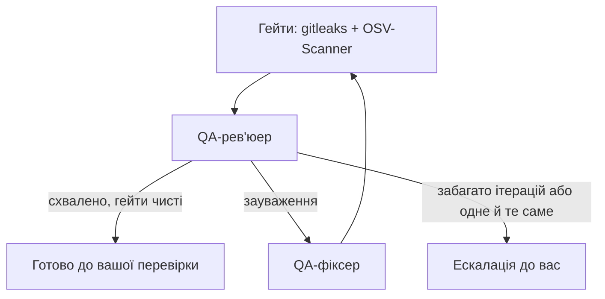

# Vibe Teamlead 2.0 — як це працює

Vibe Teamlead — застосунок для macOS, у якому команда AI-агентів на Claude Code будує софт за специфікацією. Ви описуєте задачу або завантажуєте ТЗ, а агенти проходять шлях, як справжня команда: аналітик → архітектор → планувальник → розробник (спершу тест) → QA → перевірка безпеки → ваше рішення про злиття. Ви бачите роботу наживо й відповідаєте на питання агентів, коли рішення за вами.

Застосунок виріс із форку [Auto Claude](https://github.com/AndyMik90/Auto-Claude) (AGPL-3.0) і далі переписаний під один рушій — Claude Code.

---

## Зміст

1. [Коротко: шлях задачі](#1-коротко-шлях-задачі)
2. [Екрани застосунку](#2-екрани-застосунку)
3. [Конвеєр агентів детально](#3-конвеєр-агентів-детально)
4. [Агенти і їхні ролі](#4-агенти-і-їхні-ролі)
5. [Ізоляція: worktree, гілки, злиття](#5-ізоляція-worktree-гілки-злиття)
6. [Якість і безпека](#6-якість-і-безпека)
7. [Знання проєкту: індекс, CodeGraph, пам'ять](#7-знання-проєкту-індекс-codegraph-памʼять)
8. [Інструменти агентів (MCP, скіли)](#8-інструменти-агентів-mcp-скіли)
9. [Моделі й доступ до Claude](#9-моделі-й-доступ-до-claude)
10. [Інтеграції](#10-інтеграції)
11. [Де що лежить на диску](#11-де-що-лежить-на-диску)
12. [Архітектура застосунку (для розробника)](#12-архітектура-застосунку-для-розробника)
13. [Налаштування — шпаргалка](#13-налаштування--шпаргалка)
14. [Обмеження і що варто знати](#14-обмеження-і-що-варто-знати)

---

## 1. Коротко: шлях задачі



1. **Ви створюєте задачу** (кнопка «Створити» → «Нова задача») або **завантажуєте ТЗ** (`.docx`, `.md`, `.pdf`, `.txt`, `.rtf`). Аналітик ТЗ розбиває документ на окремі задачі.
2. **Специфікація.** Агенти збирають вимоги й пишуть `spec.md` з критеріями приймання `AC-1…AC-n`. Кожен критерій має рівень тесту: unit, integration або e2e.
3. **Архітектура** (для задач середньої та високої складності). Архітектор пише `architecture.md`, рішення у форматі ADR, діаграми draw.io та Mermaid. Кожну діаграму він рендерить і виправляє, поки вона не стане чистою.
4. **План.** Планувальник розбиває роботу на фази й підзадачі. У кожної підзадачі вказано, які AC вона закриває і який тест має впасти першим.
5. **Код.** Кодер працює в ізольованій копії репозиторію (git worktree) за TDD: спершу тест, що падає, потім код, потім рефакторинг. Після кожної підзадачі — коміт.
6. **QA.** Спершу жорсткі гейти: gitleaks (секрети) та OSV-Scanner (вразливі залежності). Потім QA-рев'юер звіряє кожен AC з тестом, запускає тести, перевіряє UI в браузері й пише звіт. Якщо є зауваження, QA-фіксер виправляє, і QA повторюється.
7. **Strix** (якщо увімкнено): пентест зміненого коду в Docker.
8. **Ваша перевірка.** Ви переглядаєте зміни у Workspace задачі й вирішуєте: злити в основну гілку, створити PR або відкинути.

Поки агент працює, він може **поставити вам питання** (наприклад, «JWT чи серверні сесії?»). Праворуч з'являється панель із варіантами, і агент чекає на вашу відповідь. Можна пропустити питання — тоді агент вирішить сам і запише своє припущення.

---

## 2. Екрани застосунку

### Збірка (Build)

| Екран | Що там |
|---|---|
| **Канбан** | Задачі за колонками: *Планування → Черга → У роботі → AI-перевірка → Ваша перевірка → Готово* (також *PR створено* і *Помилка*). Дошка оновлюється наживо. Задачі з черги стартують самі, з урахуванням ліміту паралельних задач. |
| **Agent Terminals** | Термінали з Claude Code, кожен у своєму worktree, для ручної роботи поруч з агентами. Новий термінал — ⌘T. |
| **Worktrees** | Ізольовані копії репозиторію для кожної задачі: скільки комітів попереду, скільки змінено файлів. Тут же «Злити», «Створити PR», «Скопіювати шлях», «Видалити». Теки, що лишились після невдалого прибирання, позначено як «осиротілі». |
| **GitHub Issues / PRs**, **GitLab Issues / MRs** | З'являються, коли підключено GitHub або GitLab: перетворення issue на задачу, AI-рев'ю pull request-ів. |

### Планування (Plan)

| Екран | Що там |
|---|---|
| **Roadmap** | Дорожня карта продукту: агенти аналізують проєкт (і за бажанням конкурентів) та пропонують фічі за пріоритетами. Фічу можна перетворити на задачу. |
| **Ideation** | Генерація ідей за типами: покращення коду, якість, документація, продуктивність, безпека, UI/UX. Ідею можна перетворити на задачу. |
| **Insights** | Чат про ваш код. Агент читає проєкт (через CodeGraph і файли), бачить пам'ять, може запам'ятати нове. Видно, які інструменти він викликає. |

### Знання (Knowledge)

| Екран | Що там |
|---|---|
| **Context → Індекс проєкту** | «Паспорт» проєкту: сервіси, фреймворки, команди тестів, порти. Кнопка «Проаналізувати проєкт». |
| **Context → Спогади** | Що агенти запам'ятали про цей проєкт. |
| **Changelog** | Генерація changelog із завершених задач, історії git або порівняння гілок. |
| **MCP Overview** | Які MCP-сервери та інструменти має кожен агент; власні MCP-сервери; перемикачі Context7, Linear, браузерних інструментів. |

### Вікно задачі

| Вкладка | Що там |
|---|---|
| **Огляд** | Опис, статус, прогрес підзадач, кнопки «Почати», «Зупинити», «Злити», «PR». |
| **Workspace → Spec** | Критерії приймання з результатами QA (✓ / ✗ / не перевірено) і хто їх покриває; `spec.md` з відміченими чекбоксами. |
| **Workspace → Plan** | Граф залежностей підзадач (зліва направо або зверху вниз, перемикач у кутку) і хронологія «що відбувалось». |
| **Workspace → Architecture** | Діаграми (draw.io відкриваються в draw.io), `architecture.md` з вбудованими діаграмами, ADR. |
| **Workspace → Security** | Результати гейтів і Strix: знахідки з рівнем серйозності. |
| **Підзадачі** | Список підзадач і їхні статуси. |
| **Логи** | Що робив кожен агент за фазами (планування, код, перевірка): виклики інструментів, вивід команд, помилки. |
| **Файли** | Файли спеки. |

---

## 3. Конвеєр агентів детально

### 3.1 Специфікація — глибина залежить від складності

Спершу **оцінювач складності** визначає рівень задачі:

| Рівень | Фази |
|---|---|
| **Простий** | швидка спека → валідація |
| **Середній** | discovery → вимоги → спека → **архітектура** → план → валідація |
| **Складний** | discovery → вимоги → дослідження → контекст → спека → самокритика → **архітектура** → план → валідація |

Що відбувається на кожній фазі:
- **Discovery / контекст:** агенти вивчають наявний код, щоб спека відповідала реальному проєкту.
- **Дослідження:** перевірка бібліотек і API за актуальною документацією (Context7).
- **Самокритика:** окремий агент шукає дірки в спеці.
- **Валідація:** перевірка, що спека й план узгоджені й готові до роботи.

### 3.2 Spec-driven + test-first

- У кожного критерію приймання є ID (`AC-n`) і рівень тесту.
- Підзадача плану каже, який тест написати першим і які AC вона закриває.
- Кодер працює циклом red → green → refactor і комітить кожну підзадачу.
- QA будує таблицю «AC → тест → чи справді перевіряє → результат». Якщо для AC немає тесту, тест нічого не перевіряє або падає, це зауваження, і QA не схвалить роботу.

### 3.3 Цикл QA



- Знахідки гейтів блокують схвалення, навіть якщо рев'юер сказав «ок».
- Застосунок пише звіт `qa_report.md` (з таблицею AC) і план ручного тестування.
- Якщо одна проблема повторюється кілька ітерацій, задача ескалюється до вас.

### 3.4 Strix (Security QA)

Опційний пентест після схвалення QA. Він вмикається в «Налаштування → Агенти», потрібні Docker і ключ. Strix піднімає контейнер, атакує змінений код і віддає знахідки. Вони з'являються у Workspace → Security, а QA-фіксер їх виправляє. Якщо Docker, Strix або ключа немає, крок пропускається і нічого не падає. Хід роботи видно в логах фази перевірки (там є серцебиття раз на хвилину).

### 3.5 Зупинка, відновлення, черга

- **«Зупинити»** зупиняє агентів. Якщо план уже є, задача йде на вашу перевірку, якщо ні — назад у планування.
- **Відновлення:** при старті застосунок знаходить підзадачі, що «застрягли», і повертає їх у роботу. Для збоїв є окремий промпт відновлення кодера.
- **Черга:** коли є вільне місце за лімітом паралельних задач, задачі з черги стартують самі.

---

## 4. Агенти і їхні ролі

Кожен агент — це сесія Claude Code зі своїм промптом (`apps/desktop/prompts/`), набором інструментів і своєю моделлю.

| Агент | Роль |
|---|---|
| **Аналітик ТЗ** (brief_analyst) | Читає завантажений документ і розбиває його на задачі. |
| **Оцінювач складності** | Обирає глибину конвеєра специфікації. |
| **Збирач вимог, дослідник, контекст, discovery** | Готують матеріал для спеки. |
| **Специфікатор** (spec_writer) | Пише `spec.md` з AC. |
| **Критик спеки** | Шукає дірки та суперечності. |
| **Архітектор** | Пише `architecture.md`, ADR і діаграми; рендерить кожну діаграму й виправляє її. |
| **Планувальник** | Пише `implementation_plan.json`: фази, підзадачі, тест-перше, залежності. |
| **Кодер** | Пише код за підзадачами (TDD), комітить, оновлює статус підзадачі. |
| **QA-рев'юер** | Перевіряє AC, тести, UI (браузер), безпеку; пише звіт; відмічає чекбокси спеки. |
| **QA-фіксер** | Виправляє зауваження QA. |
| **Merge resolver** | Розв'язує конфлікти під час злиття. |
| **Генератори commit message / опису PR** | Пишуть повідомлення коміту й текст PR. |
| **PR-рев'юер і спеціалісти** | Рев'ю чужих PR: безпека, якість, логіка, відповідність кодовій базі. |
| **Roadmap, конкурентний аналіз, Ideation, Insights-чат, Changelog** | Утиліти планування й знань. |

---

## 5. Ізоляція: worktree, гілки, злиття

- **Окрема копія для кожної задачі.** Кожна задача працює в окремому git worktree у `.vibe-teamlead/worktrees/tasks/<spec-id>/`, на гілці `vibe-teamlead/<spec-id>`. Ваша робоча копія не чіпається, поки ви не вирішите злити.
- **Захист у самих агентах.** Агенти обмежені межами своєї копії: перевірка шляхів і allowlist bash-команд працюють як хуки Claude Code, тож агент не може писати поза worktree чи запускати небезпечні команди.
- **«Злити»** переносить зміни в основну гілку (обрана в налаштуваннях проєкту, інакше визначається автоматично). Конфлікти допомагає розв'язати merge resolver. Після повного злиття worktree і гілка задачі видаляються.
- **Злиття лише в індекс.** Є режим, де зміни лише додаються в індекс і можна закомітити вручну.
- **«Створити PR»** пушить гілку задачі й відкриває PR через `gh`. Потрібен віддалений репозиторій GitHub (`origin`); без нього кнопка неактивна.
- **Прибирання безпечне.** Воно ніколи не видаляє гілку, яка не є гілкою задачі.

---

## 6. Якість і безпека

| Шар | Що робить |
|---|---|
| **TDD + AC** | Кожна вимога має тест; QA перевіряє, що тест справді її тримає. |
| **gitleaks** | Секрети в коді блокують схвалення. |
| **OSV-Scanner** | Вразливі залежності блокують схвалення. |
| **Браузерна перевірка** | QA відкриває застосунок у Chrome (Playwright / DevTools MCP), робить скріншоти й дивиться консоль. |
| **Strix** | Пентест у Docker (опційно). |
| **Хуки безпеки** | Межі шляхів, allowlist команд, заборона вбивати процеси самого застосунку. |
| **Ізоляція оточення** | Агенти працюють з власною конфігурацією Claude Code (`~/.vibe-teamlead/claude-code`), а не з вашою `~/.claude`. Змінні оточення фільтруються. |

Сканери (gitleaks, OSV-Scanner), Claude Code, CodeGraph, Superpowers і Mermaid вбудовані в застосунок і нічого не треба ставити окремо. Docker і Chrome потрібні лише для Strix і браузерних перевірок. Стан усіх інструментів видно в «Налаштування → Tools».

---

## 7. Знання проєкту: індекс, CodeGraph, пам'ять

Це три різні речі.

### Індекс проєкту — «паспорт»

`.vibe-teamlead/project_index.json` описує проєкт загалом:
- з яких сервісів він складається, їхні мови та фреймворки;
- команди запуску, тестів і збірки, порти, Docker;
- тип застосунку (веб, Electron, бекенд).

Хто ним користується:
- агенти спеки, архітектури, плану й QA — щоб планувати під реальну структуру;
- застосунок — щоб вирішити, які інструменти дати (браузер для QA, чи потрібен Strix).

Перед QA він перераховується з коду сам. Кнопка в «Контекст → Індекс проєкту» потрібна, щоб подивитися паспорт або оновити його вручну.

### CodeGraph — карта коду

Граф символів: функції, класи, хто кого викликає, що зачепить зміна.
- **Індексація:** автоматично перед стартом агента, окремо для кожного worktree (`.codegraph/`, не потрапляє в git). Поки агент редагує код, граф оновлюється.
- **Використання:** агенти питають його (`codegraph_search`, `callers`, `impact`…) замість grep і читання файлів наосліп. Це швидше й дешевше.
- **Де видно:** у логах задачі рядки «CodeGraph: index ready / attached» і виклики його інструментів.

### Пам'ять — досвід агентів

- **Що:** підводні камені, патерни, нотатки про файли, підходи, що не спрацювали.
- **Як потрапляє:**
  - автоматично після кожної підзадачі: модель витягує висновки зі змін (git diff) і розмови кодера, до 12 записів;
  - агенти можуть свідомо записати щось інструментом `remember`.
- **Як використовується:**
  - перед стартом архітектора, планувальника, кодера й QA найдоречніші спогади йдуть у промпт як підказки, які треба перевірити по коду;
  - під час роботи агенти шукають самі (`search_memory`);
  - чат Insights теж бачить пам'ять.
- **Де:** локально в `~/.vibe-teamlead/memories`, окремо для кожного проєкту. Переглянути — «Контекст → Спогади». Вмикається, і там же обирається модель ембеддингів, у «Налаштування → Пам'ять». Без моделі ембеддингів пошук іде за ключовими словами.

Перша задача в проєкті стартує з порожньою пам'яттю. Користь видно з другої-третьої задачі.

---

## 8. Інструменти агентів (MCP, скіли)

| Що | Для чого |
|---|---|
| **Інструменти Vibe Teamlead** (`mcp__vibe-teamlead__*`) | Статус підзадач, прогрес збірки, запис відкриттів і підводних каменів, статус QA, пам'ять (`search_memory`, `remember`), рендер діаграм (`render_diagram`: draw.io/Mermaid → PNG). |
| **CodeGraph** (`mcp__codegraph__*`) | Карта коду (див. вище). |
| **Context7** | Актуальна документація бібліотек (хостований HTTP-сервер). Допомагає не писати за застарілим API. Опційно з ключем `CONTEXT7_API_KEY`. |
| **Браузер** (Playwright / Chrome DevTools MCP) | QA перевіряє UI. |
| **Electron MCP** | QA для Electron-застосунків. |
| **Linear** | Робота із задачами Linear (якщо підключено). |
| **Власні MCP-сервери** | Додаються в MCP Overview і призначаються агентам. |
| **Superpowers** (вбудований плагін) | Набір скілів Claude Code: TDD, дебаг, планування тощо. |
| **Скіл architecture** | Стандарт документа архітектури, діаграм і циклу перевірки для архітектора. |

---

## 9. Моделі й доступ до Claude

### Доступ («Налаштування → Claude»)

Два режими, перемикач угорі:
- **API-ключ:** ключ Anthropic або сумісного шлюзу плюс опційний **base URL**. Так працює, наприклад, Meter → Ollama: `https://gw.metergateway.com/ollama`.
- **Підписка Claude:** токен з `claude setup-token`, лише для власного комп'ютера (у збірках для інших людей не вмикати). Base URL не використовується.

Обидва ключі зберігаються окремо, зашифровані в Keychain macOS. Сесії беруть ключ лише обраного режиму, без тихої підміни. Кнопка «Перевірити з'єднання» тестує ключ обраного режиму.

### Моделі

- **Профіль агентів** («Налаштування → Агенти»): моделі та рівень «мислення» для кожної фази — спека, планування, код, QA.
- **Свої моделі для фаз:** можна вказати модель окремо для кожної фази. Список береться з вашого endpoint (Anthropic або шлюзу).
- **Моделі функцій:** окремі моделі для Insights, Roadmap, Ideation, аналізу ТЗ тощо. Аналіз ТЗ наслідує модель Roadmap, поки не задано свою.
- **Не-Claude моделі** (glm, kimi, qwen через шлюз) працюють. Застосунок підставляє обрану модель і туди, де Claude Code інакше звертався б до своїх «малих» моделей.

---

## 10. Інтеграції

| Інтеграція | Що дає |
|---|---|
| **GitHub** («Налаштування → GitHub») | Репозиторій і токен (через GitHub App або власний токен), issues → задачі, PR, рев'ю PR. Базова гілка й «пушити нові гілки» доступні й без підключення GitHub. |
| **GitLab** | Те саме для GitLab: issues і merge requests. |
| **Linear** | Синхронізація задач і Linear MCP для агентів. |
| **draw.io** | Діаграми архітектури відкриваються в draw.io однією кнопкою. |
| **IDE / термінал** | Відкрити worktree у вашому редакторі чи терміналі («Налаштування → Developer Tools»). |

---

## 11. Де що лежить на диску

| Шлях | Що |
|---|---|
| `<проєкт>/.vibe-teamlead/specs/<id>/` | Усе про задачу: `spec.md`, `requirements.json`, `implementation_plan.json`, `architecture/` (md, ADR, діаграми + PNG), `qa_report.md`, `MANUAL_TEST_PLAN.md`, `task_logs.json`, результати безпеки. |
| `<проєкт>/.vibe-teamlead/worktrees/tasks/<id>/` | Worktree задачі (гілка `vibe-teamlead/<id>`). |
| `<проєкт>/.vibe-teamlead/project_index.json` | Індекс проєкту. |
| `<worktree>/.codegraph/` | Індекс CodeGraph. |
| `~/.vibe-teamlead/memories` | Пам'ять агентів. |
| `~/.vibe-teamlead/claude-code` | Окрема конфігурація Claude Code для агентів. |
| Папка даних застосунку (Electron `userData` у `~/Library/Application Support/`) | Налаштування застосунку, зашифровані ключі. |

`.vibe-teamlead/` додається в `.gitignore` проєкту. Старі дані від Auto Claude (`.auto-claude/`, гілки `auto-claude/*`, `~/.auto-claude/memories`) переносяться автоматично під час першого запуску.

---

## 12. Архітектура застосунку (для розробника)

```text
apps/desktop/
├── prompts/                 # Промпти ролей агентів
├── vendor/                  # Superpowers, скіли Vibe Teamlead
├── design/DESIGN-SYSTEM.md  # Дизайн-система (спільна з Meter)
└── src/
    ├── main/                # Electron main process
    │   ├── ai/
    │   │   ├── claude-code/     # Agent SDK runner, task API, auth, моделі, MCP, CodeGraph
    │   │   ├── agent/           # Worker thread + bridge (стрім подій, питання агентів, пам'ять, діаграми)
    │   │   ├── orchestration/   # Конвеєри: spec → build → QA
    │   │   ├── config/          # AGENT_CONFIGS: інструменти та MCP на кожного агента
    │   │   ├── security/        # Гейти, Strix, bash allowlist, межі шляхів
    │   │   ├── memory/          # Пам'ять (libSQL + ембеддинги + пошук)
    │   │   ├── tools/app-tools/ # Інструменти MCP-сервера vibe-teamlead
    │   │   └── runners/         # Утиліти: insights, roadmap, ideation, PR-рев'ю, changelog
    │   ├── ipc-handlers/        # Main ↔ renderer
    │   └── github-auth/         # GitHub App device flow + Keychain
    ├── renderer/            # React UI (Tailwind v4, дизайн-система)
    ├── preload/             # Безпечний міст window.electronAPI
    └── shared/              # Типи, константи, i18n (en, uk)
```

Ключові принципи:
- **Лише Claude Code.** Кожен виклик моделі йде через Claude Agent SDK: `runAgentSession()` для агентів конвеєра (у worker thread), `runClaudeTask()` для решти.
- **Worker thread без Electron.** Агенти працюють в окремому потоці; доступ до головного процесу (пам'ять, рендер діаграм) — через запити до моста.
- **Дизайн-система:** приладова панель, ink/ground, вермільйон лише як сигнал уваги, радіус 0, без тіней; Archivo + Inter Tight (кирилиця) + IBM Plex Mono.
- **i18n:** весь текст UI через ключі `react-i18next`; локалі `en` і `uk`, паритет ключів перевіряється тестом.
- **macOS first:** збірки arm64 і x64 (`npm run package:mac`).

Команди:

```bash
npm run install:all          # з кореня репозиторію
cd apps/desktop
npm run dev                  # застосунок з hot reload
npm run typecheck
npm run lint
npm test                     # Vitest
npm run package:mac          # збірка .app / .dmg
```

---

## 13. Налаштування — шпаргалка

| Розділ | Що там |
|---|---|
| **Вигляд / Дисплей / Мова** | Тема (світла/темна/системна), масштаб, мова (українська/англійська). |
| **Developer Tools** | IDE і термінал для «відкрити в…», YOLO-режим для ручних терміналів. |
| **Terminal Fonts** | Шрифти терміналів. |
| **Claude** | Режим доступу (API-ключ / підписка), ключі, base URL, перевірка з'єднання. |
| **Tools** | Стан вбудованих і зовнішніх інструментів (сканери, Chrome, Docker, Strix, CodeGraph). |
| **Агенти** | Профіль моделей, моделі фаз і функцій, Security QA (Strix). |
| **Пам'ять** | Увімкнути/вимкнути, модель ембеддингів. |
| **Paths / Updates / Notifications / Debug** | Шляхи, оновлення, сповіщення, логи для діагностики. |
| **Проєкт → General** | Модель агентів проєкту, CLAUDE.md, сповіщення. |
| **Проєкт → GitHub / GitLab / Linear** | Репозиторій, токен, базова гілка, пуш гілок, синхронізація issues. |
| **Майстер налаштування** | Перший запуск: Claude, інструменти, Dev Tools, приватність, пам'ять. Можна запустити знову. |

---

## 14. Обмеження і що варто знати

- **Слабші моделі** (через шлюз) гірше дотримуються інструкцій: частіше йдуть у grep замість CodeGraph, можуть не відмітити чекбокси спеки. Для архітектури, планування й QA краще сильніші моделі.
- **Strix навантажує процесор**, поки працює контейнер. Це нормально, після завершення Docker прибирається.
- **PR потребує GitHub `origin`**; злиття працює і без нього.
- **Підписку Claude** вмикайте лише на власному комп'ютері. Ліміти спільні з вашим звичайним використанням Claude.
- **Перейменування гілок при переїзді з Auto Claude** торкається лише локальних гілок; уже запушені гілки зберігають стару назву.
